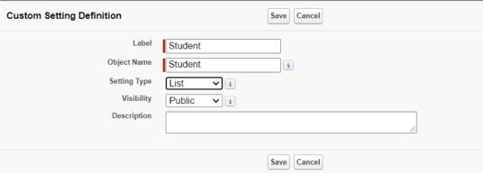
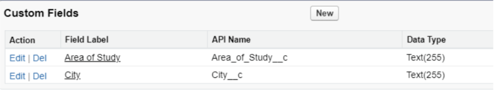
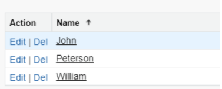

Salesforce and Vlocity

Salesforce CPQ

Service cloud

Sales cloud

Omnistudio

Salesforce CG

Pardot

copado

[https://trailhead.salesforce.com/users/strailhead/trailmixes/prepare-for-your-salesforce-platform-developer-ii-credential](https://trailhead.salesforce.com/users/strailhead/trailmixes/prepare-for-your-salesforce-platform-developer-ii-credential)

[https://trailhead.salesforce.com/users/strailhead/trailmixes/prepare-for-your-salesforce-javascript-developer-i-credential](https://trailhead.salesforce.com/users/strailhead/trailmixes/prepare-for-your-salesforce-javascript-developer-i-credential)

Apex Specialist

New maintenance req

- Same vehicle
- Equipment records
- New equipment maintenance items
- Type: routine maintenance
- Report date: created date.
- Due date: created date + min maintenance cycle of all equipment.

After Insert:

- Fetch old EMitems and clone

MR0001

- EqMI1
- Eq1
- EqMI2
- Eq2
- Due Date
- Date Reported
- vehicle

MR0001Copy

- EqMI3
-Eq1
- EqMI4
-Eq2

# Custom Metadata Types

Here is a **concise summary of the blog**:
[Custom Metadata Types Guide (Apex Hours)](https://www.apexhours.com/custom-metadata-types/?utm_source=chatgpt.com)

**Custom Metadata Types – Concise Summary**

**1. What Custom Metadata Types Are**

- **Custom Metadata Types (CMDT)** store **configuration data as** **metadata** in Salesforce.
- Similar to **custom** **objects**, but records are treated as **metadata instead of regular data**.
- API names end with **__****mdt** (e.g., Integration_Config__mdt). ([Apex Hours](https://www.apexhours.com/custom-metadata-types/?utm_source=chatgpt.com))

They help developers build **dynamic and configurable applications** where logic can be controlled by metadata instead of hard-coded values. ([Apex Hours](https://www.apexhours.com/custom-metadata-types/?utm_source=chatgpt.com))

**2. Why Use Custom Metadata Instead of Custom Objects**

Key advantages:

- **Faster access** because metadata records are **cached in memory**.
- **Does not count against SOQL governor limits**.
- **Records are deployable** across orgs (Change Sets, Metadata API, packages).
- Commonly used by **ISVs and scalable apps**. ([Apex Hours](https://www.apexhours.com/custom-metadata-types/?utm_source=chatgpt.com))

Custom objects:

- Not cached
- Queries consume **SOQL limits**
- Data must be migrated manually across orgs.

**3. Accessing Custom Metadata in Apex**

Salesforce provides methods to fetch metadata records:

**Get all records**

Map<String, My_Config__mdt> configs = My_Config__mdt.getAll();

**Get a specific record**

My_Config__mdt record = My_Config__mdt.getInstance('DeveloperName');

Or by record Id.

These methods allow **fast retrieval without standard SOQL queries**. ([Apex Hours](https://www.apexhours.com/custom-metadata-types/?utm_source=chatgpt.com))

**4. How to Create Custom Metadata Types**

Steps:

1. Go to **Setup**
1. Search **Custom Metadata Types**
1. Click **New Custom Metadata Type**
1. Define fields
1. Click **Manage Records** to create configuration records. ([Apex Hours](https://www.apexhours.com/custom-metadata-types/?utm_source=chatgpt.com))

**5. Custom Metadata vs Custom Settings**

Key differences:

| **Feature** | **Custom Metadata** | **Custom Settings** |
| --- | --- | --- |
| Deploy records | ✅ Yes | ❌ No |
| Hierarchy support | ❌ No | ✅ Yes |
| Relationship fields | ✅ Supported | ❌ Not supported |
| Visible in test classes | ✅ Yes | ❌ No |
| API suffix | __mdt | __c |

Recommendation from the article:

- Use **Custom Metadata for deployable configuration**
- Use **Custom Settings when hierarchy is required**. ([Apex Hours](https://www.apexhours.com/difference-between-custom-setting-and-custom-metadata-salesforce/?utm_source=chatgpt.com))

**6. Typical Use Cases**

Custom Metadata is useful for:

- Integration configuration
- Feature flags
- Business rules
- Mapping tables
- Dynamic application behavior

It allows **admins to change behavior without modifying code**.

✅ **One-line takeaway**

Custom Metadata Types store **deployable, cached configuration data** that Apex can use to build **dynamic and scalable Salesforce applications**.

If you want, I can also give you a **5-minute interview cheat sheet for Custom Metadata Types** (what senior Salesforce devs are expected to know).

# Custom Setting

| **List Custom Settings** | **Hierarchy Custom Settings** |
| --- | --- |
| It provides a reusable set of static data which can be accessed across your organization. | It uses a built-in hierarchical logic which lets you personalize settings for a specific user or a profile. |
| The data in List Custom Settings is directly visible to any user in the org. .getAll(); getValues() | The data in Hierarchy Custom Settings checks the organization, profile and user settings for the current user and makes the data visible for them accordingly. .getInstance(); .getInstance(userId/ProfileId); .getOrgDefaults(); |

- The main advantage of using Custom Settings is that the data is cached, which enables efficient access without the cost of repeated queries to the database.
- One doesn’t have to use SOQL queries which count against the governor limits.

Note: If the setting type is disabled, go to schema settings from setup and enable “Manage list custom settings type”.

**How to create a Custom Settings?**

Search for Custom Settings in your setup, and create new Custom Setting and enter the required information in the fields.

**Note**: If the setting type is disabled, go to schema settings from setup and enable “**Manage list custom settings type**”.

Now, create Custom fields under the custom setting definition that we just created.

Now Click on Manage from the custom setting definition to add data.

Now that we have created a List Custom Setting, Let’s see how to access it in your apex.

**Accessing List Custom Setting data**

We can access the data using the custom settings methods. They are all instance methods, that is, they are called by and operate on a specific instance of a custom setting.

- To fetch the custom fields associated with a list setting, use getAll() method. It returns a map of data set names and custom setting records

Map<String_data_set_name, CustomSettingApiName> var = CustomSettingApiName.getAll();

Eg: Map<String, Student__c> students = Student__c.getAll();

- To fetch all the field values associated with the specified dataset, use getValues() method. This method can be used for both list and hierarchy settings.

CustomSettingApiName var = CustomSettingApiName.getValues(dataset_name);

Eg: Student__c stud = Student__c.getValues('John');

**Accessing Hierarchy Custom Setting data**

You can similarly try accessing the Hierarchy Custom Setting data with the following methods.

- To return a custom setting data set record for the current logged in user. Use the getInstance() method.

CustomSettingApiName var = CustomSettingApiName.getInstance();

- To return a custom setting data set record for a specific userId/ProfileId, Use the getInstance(userId/ProfileId) method.

CustomSettingApiName var = CustomSettingApiName.getInstance(userId/ProfileId);

- To return the custom setting record data set for the organization, Use the getOrgDefaults() method

CustomSettingApiName var = CustomSettingApiName.getOrgDefaults();

**Note: To make the Custom Setting data visible in your apex test class, use “****seeAllData****=true”.**

**Limits on Custom Settings**

Here are a few limits that needs to be considered before using Custom Settings

- We can have up-to 300 fields per custom setting.
- Sharing a Custom Setting object or record is not possible.
- Since the Custom Settings are a type of custom object, each custom setting counts against the total number of custom objects available in your org.
- The total amount of cached data allowed for your org is the lesser of these two values:
  - 10 MB
  - 1 MB multiplied by the number of full featured user licenses in your org.

For example, if your org has three full licenses, you have 3 MB of custom setting storage. If your org has 20 org licenses, you have 10 MB of storage.

# Field History Tracking

- select certain fields to track and display the field history in the History related list of an object.
- When Field Audit Trail isn't enabled, field history data is retained for up to 18 months, and up to 24 months via the API.
- If Field Audit Trail is enabled, field history data is retained until manually deleted.
- Field history tracking data doesn’t count against your data storage limits.
- For example, AccountHistory represents the history of changes to the values of an Account record’s fields. Similarly, MyCustomObject__History tracks field history for the MyCustomObject__c custom object.
- Changes to fields with more than 255 characters are tracked as edited, and their old and new values aren’t recorded.
- Changes to time fields aren’t tracked in the field history related list.
- The Field History Tracking timestamp is precise to a second in time. In other words, if two users update the same tracked field on the same record in the same second, both updates have the same timestamp. Salesforce can’t guarantee the commit order of these changes to the database. As a result, the display values can look out of order.
- In Lightning, you can see gaps in numerical order in the Created Date and ID fields. All tracked changes are still committed and recorded to your audit log. However, the exact time that those changes occur in the database can vary widely and aren't guaranteed to occur within the same millisecond. For example, there can be triggers or updates on a field that increase the commit time, and you can see a gap in time. During that time period, IDs are created in increasing numerical order but can also have gaps for the same reason.
- If Process Builder, an Apex trigger, or a Flow causes a change on an object the current user doesn’t have permission to edit, that change isn’t tracked. Field history honors the permissions of the current user and doesn’t record changes that occur in system context.
- Salesforce attempts to track all changes to a history-tracked field, even if a particular change is never stored in the database. For example, let’s say an admin defines an Apex before trigger on an object that changes a Postal Code field value of 12345 to 94619. A user adds a record to the object and sets the Postal Code field to 12345. Because of the Apex trigger, the actual Postal Code value stored in the database is 94619. Although only one value was eventually stored in the database, the tracked history of the Zip Code field has two new entries:
  - No value --> 12345 (the change made by the user when they inserted the new record)
  - 12345 --> 94619 (the change made by the Apex trigger)
