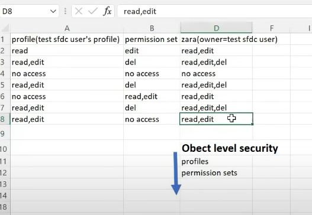
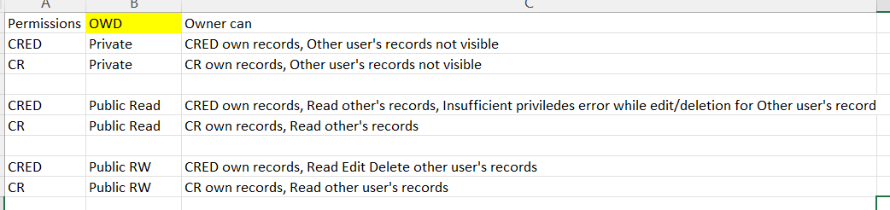
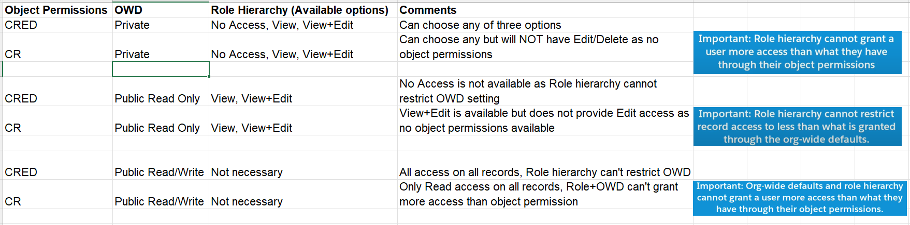
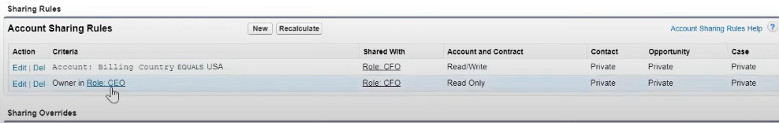

# Security model

**x****Data Security Model Salesforce**

**Org** **Access****(****Network access)**

- **IP ranges**
- Company level – Users outside range are sent activation code.
- Profile level – Users outside range are denied access.
- **Login Hours** – At profile level, session ends outside hours.

**Object level security (CRUD permissions)**

- **Profiles** – Most restrictive access should be given at profile level. 
- Defines tabs user can see
- Apps user can access
- Objects users can access
- What users can do with object records(CRUD)
- Login hours and IP ranges
- **Permission sets** **and Groups** – Permissions are extended to users with permission sets.

**Record level security**

- **OWD org wide default** – Decides whether records will be Private, Public read only, Public read/write. 
- Private – only visible to record owner
- Public read only – All records visible but not editable
- public read write – All records visible and editable.
- Public read write transfer – Allow non owners to view edit and change ownership. 
   leads and cases.
- Controlled by Parent

- **Role hierarchy** – Users can have access to own and subordinate’s records if “grant using hierarchy” is checked for that object even in private/ public read only OWD. 
This feature opens up access to records when OWD set to anything more restrictive than Public read/write

- **Sharing rules** – Extends record access to other users based on
- Owner
- Criteria

- **Manual sharing** – To share individual records with users.

**Field level security**

- Control whether a user can see, edit, and delete the value for a particular field on an object. They let you protect sensitive fields without having to hide the whole object from users. Field permissions are also controlled in permission sets and profiles.
