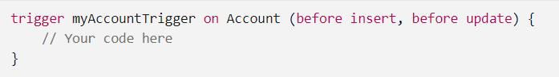
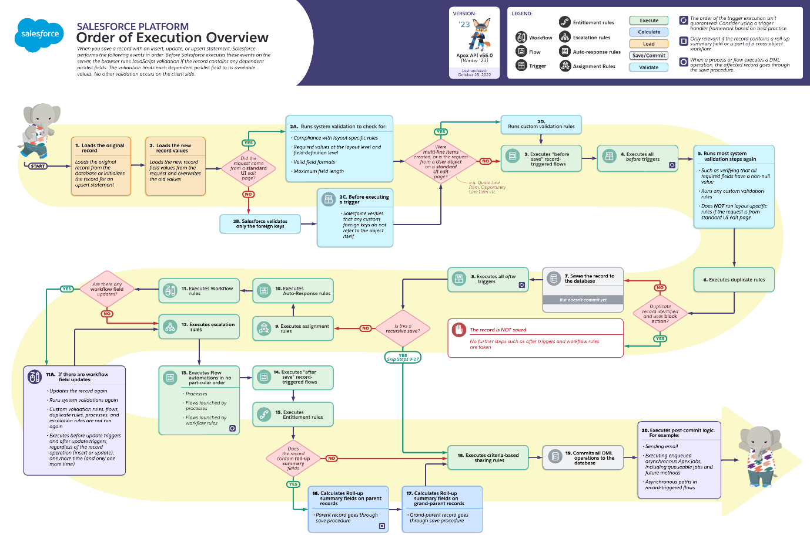

**Triggers**

Apex triggers enable you to perform custom actions before or after changes to Salesforce records. A trigger is Apex code that executes before or after the following types of operations:

- insert
- update
- delete
- merge
- upsert
- undelete

There are two types of triggers:

- *Before triggers* are used to update or validate record values before they’re saved to the database.
- *After triggers* are used to access field values that are set by the system (such as a record's Id or LastModifiedDate field), and to affect changes in other records, such as logging into an audit table or firing asynchronous events with a queue. The records that fire the *after trigger* are read-only.

**Because triggers** can cause other records to change, and because these changes can, in turn, fire more triggers, the Apex runtime engine considers all such operations a single unit of work and sets limits on the number of operations that can be performed to prevent infinite recursion. See [Execution Governors and Limits](https://developer.salesforce.com/docs/atlas.en-us.apexcode.meta/apexcode/apex_gov_limits.htm).

**If you update** or delete a record in its before trigger, or delete a record in its after trigger, you will receive a runtime error. This includes both direct and indirect operations. For example, if you update account A, and the before update trigger of account A inserts contact B, and the after insert trigger of contact B queries for account A and updates it using the DML update statement or database method, then you are indirectly updating account A in its before trigger, and you will receive a runtime error.

## Implementation Considerations

Before creating triggers, consider the following:

- upsert triggers fire both before and after insert or before and after update triggers as appropriate.
- merge triggers fire both before and after delete for the losing records, and both before and after update triggers for the winning record. See [Triggers and Merge Statements](https://developer.salesforce.com/docs/atlas.en-us.apexcode.meta/apexcode/apex_triggers_merge_statements.htm).
- Triggers that execute after a record has been undeleted only work with specific objects. See [Triggers and Recovered Records](https://developer.salesforce.com/docs/atlas.en-us.apexcode.meta/apexcode/apex_triggers_recovered_records.htm).
- Field history is not recorded until the end of a trigger. If you query field history in a trigger, you don’t see any history for the current transaction.
- Field history tracking honors the permissions of the current user. If the current user doesn’t have permission to directly edit an object or field, but the user activates a trigger that changes an object or field with history tracking enabled, no history of the change is recorded.
- Callouts must be made asynchronously from a trigger so that the trigger process isn’t blocked while waiting for the external service's response. The asynchronous callout is made in a background process, and the response is received when the external service returns it. To make an asynchronous callout, use asynchronous Apex such as a future method. See [Invoking Callouts Using Apex](https://developer.salesforce.com/docs/atlas.en-us.apexcode.meta/apexcode/apex_callouts.htm) for more information.
- In API version 20.0 and earlier, if a Bulk API request causes a trigger to fire, each chunk of 200 records for the trigger to process is split into chunks of 100 records. In Salesforce API version 21.0 and later, no further splits of API chunks occur. If a Bulk API request causes a trigger to fire multiple times for chunks of 200 records, governor limits are reset between these trigger invocations for the same HTTP request.
- All triggers are bulk triggers by default, and can process multiple records at a time. You should always plan on processing more than one record at a time. Bulk triggers can handle both single record updates and bulk operations
- Syntax :
- trigger_events:- 
before insert

- before update
- before delete
- after insert
- after update
- after delete
- after undelete
- **Trigger Context Variables****:** All triggers define implicit variables that allow developers to access run-time context. These variables are contained in the System.Trigger class
  - **isExecuting**
  - isInsert
  - isUpdate
  - isDelete
  - isBefore
  - isAfter
  - isUndelete
  - new: Returns a list of the new versions of the sObject records. This sObject list is only available in insert, update, and undelete triggers, and the records can only be modified in before triggers.
  - newMap:  A map of IDs to the new versions of the sObject records. This map is only available in before update, after insert, after update, and after undelete triggers.
  - old:  Returns a list of the old versions of the sObject records. This sObject list is only available in update and delete triggers.
  - oldMap:  A map of IDs to the old versions of the sObject records. This map is only available in update and delete triggers.
  - operationType:  Returns an enum of type System.TriggerOperation corresponding to the current operation. Possible values of the System.TriggerOperation enum are: BEFORE_INSERT, BEFORE_UPDATE, BEFORE_DELETE,AFTER_INSERT, AFTER_UPDATE, AFTER_DELETE, and AFTER_UNDELETE. If you vary your programming logic based on different trigger types, consider using the switch statement with different permutations of unique trigger execution enum states.
  - Size
- **Context Variable Consideration****s**
  - trigger.new and trigger.old cannot be used in Apex DML operations.
  - You can use an object to change its own field values using trigger.new, but only in before triggers. In all after triggers, trigger.new is not saved, so a runtime exception is thrown.
  - trigger.old is always read-only.
  - You cannot delete trigger.new.

| **Trigger Event** | **Can change fields using** **trigger.new** | **Can update original object using an update DML operation** | **Can delete original object using a delete DML operation** |
| --- | --- | --- | --- |
| before insert | Allowed. | Not applicable. The original object has not been created; nothing can reference it, so nothing can update it. | Not applicable. The original object has not been created; nothing can reference it, so nothing can update it. |
| after insert | Not allowed. A runtime error is thrown, as trigger.new is already saved. | Allowed. | Allowed, but unnecessary. The object is deleted immediately after being inserted. |
| before update | Allowed. | Not allowed. A runtime error is thrown. | Not allowed. A runtime error is thrown. |
| after update | Not allowed. A runtime error is thrown, as trigger.new is already saved. | Allowed. Even though bad code could cause an infinite recursion doing this incorrectly, the error would be found by the governor limits. | Allowed. The updates are saved before the object is deleted, so if the object is undeleted, the updates become visible. |
| before delete | Not allowed. A runtime error is thrown. trigger.new is not available in before delete triggers. | Allowed. The updates are saved before the object is deleted, so if the object is undeleted, the updates become visible. | Not allowed. A runtime error is thrown. The deletion is already in progress. |
| after delete | Not allowed. A runtime error is thrown. trigger.new is not available in after delete triggers. | Not applicable. The object has already been deleted. | Not applicable. The object has already been deleted. |
| after undelete | Not allowed. A runtime error is thrown. | Allowed. | Allowed, but unnecessary. The object is deleted immediately after being inserted. |

# Triggers and Recovered Records

after undelete trigger event only works with recovered records.

after undelete trigger events only run on top-level objects. For example, if you delete an Account, an Opportunity may also be deleted. When you recover the Account from the Recycle Bin, the Opportunity is also recovered. If there is an after undelete trigger event associated with both the Account and the Opportunity, only the Account after undelete trigger event executes.

The after undelete trigger event only fires for the following objects:

- Account
- Asset
- Campaign
- Case
- Contact
- ContentDocument
- Contract
- Custom objects
- Event
- Lead
- Opportunity
- Product
- Solution
- Task

# Triggers and Order of Execution

- Before Salesforce executes these events on the server, the browser runs JavaScript validation if the record contains any dependent picklist fields. The validation limits each dependent picklist field to its available values. No other validation occurs on the **client side**.
- On the server,
1. Loads the original record from the database or initializes the record for an upsert statement.
1. Loads the new record field values from the request and overwrites the old values.

Salesforce performs different validation checks depending on the type of request.

  - For requests from a standard UI edit page, Salesforce runs these system validation checks on the record:
    - Compliance with layout-specific rules
    - Required values at the layout level and field-definition level
    - Valid field formats
    - Maximum field length

Additionally, if the request is from a User object on a standard UI edit page, Salesforce runs custom validation rules.

  - For requests from multiline item creation such as quote line items and opportunity line items, Salesforce runs custom validation rules.
  - For requests from other sources such as an Apex application or a SOAP API call, Salesforce validates only the foreign keys and restricted picklists. Before executing a trigger, Salesforce verifies that any custom foreign keys don’t refer to the object itself.
1. Executes record-triggered flows that are configured to run before the record is saved.
1. Executes all before triggers.
1. Runs most system validation steps again, such as verifying that all required fields have a non-null value, and runs any custom validation rules. The only system validation that Salesforce doesn't run a second time (when the request comes from a standard UI edit page) is the enforcement of layout-specific rules.
1. Executes duplicate rules. If the duplicate rule identifies the record as a duplicate and uses the block action, the record isn’t saved and no further steps, such as after triggers and workflow rules, are taken.
1. Saves the record to the database, but doesn't commit yet.
1. Executes all after triggers.
1. Executes assignment rules.
1. Executes auto-response rules.
1. Executes workflow rules. If there are workflow field updates:

Note

This sequence applies only to workflow rules.

  - Updates the record again.
  - Runs system validations again. Custom validation rules, flows, duplicate rules, processes, and escalation rules aren’t run again.
  - Executes before update triggers and after update triggers, regardless of the record operation (insert or update), one more time (and only one more time)
1. Executes escalation rules.
1. Executes these Salesforce Flow automations, but not in a guaranteed order.
  - Processes
  - Flows launched by processes
  - Flows launched by workflow rules (flow trigger workflow actions pilot)

When a process or flow executes a DML operation, the affected record goes through the save procedure.

1. Executes record-triggered flows that are configured to run after the record is saved
1. Executes entitlement rules.
1. If the record contains a roll-up summary field or is part of a cross-object workflow, performs calculations and updates the roll-up summary field in the parent record. Parent record goes through save procedure.
1. If the parent record is updated, and a grandparent record contains a roll-up summary field or is part of a cross-object workflow, performs calculations and updates the roll-up summary field in the grandparent record. Grandparent record goes through save procedure.
1. Executes Criteria Based Sharing evaluation.
1. Commits all DML operations to the database.
1. After the changes are committed to the database, executes post-commit logic are executed. Examples of post-commit logic (in no particular order) include:
  - Sending email
  - Enqueued asynchronous Apex jobs, including queueable jobs and future methods
  - Asynchronous paths in record-triggered flows

# Scenario Questions:

[https://www.youtube.com/watch?v=JzFvtqqLiMo&ab_channel=SFDCNinja](https://www.youtube.com/watch?v=JzFvtqqLiMo&ab_channel=SFDCNinja)

# Best Practices:

  - One Trigger Per Object
  - Logic-less Triggers
  - Context-Specific Handler Methods
  - Bulkify your Code
  - Avoid SOQL Queries or DML statements inside FOR Loops
  - Using Collections, Streamlining Queries, and Efficient For Loops
  - Querying Large Data Sets - a SOQL query for loop must be used. It can process multiple batches of records using internal calls to query and queryMore.
  - Use @future Appropriately
  - Avoid Hardcoding IDs
