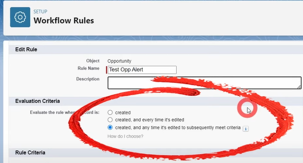
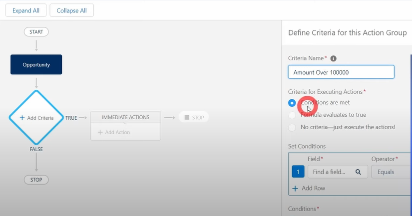
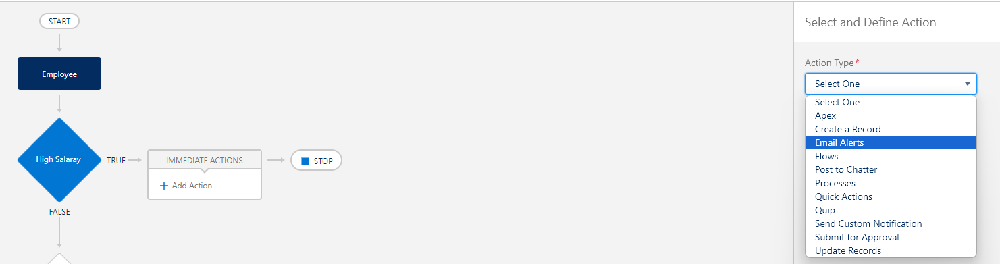

# Workflow rules

Automation that can be performed on

- Record creation.
- Record edit.
- Record edit when a criteria satisfies which was not before

Workflow rules can perform below actions (Immediately or Time-Dependent):

- Filed updates
- Task creation
- Email alerts
- Outbound messages

# Process builder

Process Builder supports three types of processes for your automation needs. The type determines what triggers the process.

- A record change process starts when a record is created or updated.
- A platform event message is received.
- It’s involved by another process.

Each process consists of:

- Criteria that determine when to execute an action group.
- Action groups, which consist of immediate or scheduled actions. Only record change processes support scheduled actions.

Actions a process can perform:

- Call apex.
- Create a record.
- Email alert.
- Run Flows.
- Post to chatter.
- Run other Processes.
- Perform Quick Actions
- Quip
- Send custom Notification.
- Submit for approval.
- Update Records.

# Flows

Automated process that can be perform certain actions on fulfilment of certain criteria or at desired time.

## Types of Flows

- Screen Flow
- Record-triggered
- Schedule-triggered
- Platform Event-triggered
- Autolaunched
- Record triggered Orchestration

## Types of Elements

## Interaction elements

- Screen
- Action
- Subflow

## Logic elements

- Assignment
- Decision
- Loop
- Transform
- Collection Sort
- Collection Filter

## Data Elements

- Create Records
- Update Records
- Get Records
- Delete Records
- Roll Back Records

## Types of Elements

## Record Triggered Flow

Can be triggered when a record is:

- Created
- Updated
- Created or Updated
- Deleted

## Screen Flow

## Schedule Triggered Flow

## Platform Event Triggered Flow

## Autolaunched Flow

## Record Triggered Orchestration

# Approval Process

# Email to Case in Salesforce

### 1. Enable on Email-to-Case

- Click on Setup and then enter **Email-To-Case** in **Quick find**.
- Then, Select Email-to-Case and click on the edit button
- Select Enable **Email-To-Case** and **On-Demand Service** then click on **Save**.

### 2. Routing Addresses for Email-to-Case

- Click on the **New** button from the **Routing Addresses** related list.
- Provide all required fields and configure **verification email** and **case settings**.
- Then click on **Save**.
- Once done then, Salesforce will send you one email to your Email Address to verify the email ID.

### 3. Setting Up Routing/Forwarding Rules

## Some important Functionality

- It automatically populates the contact and account if the contact is in Salesforce with the same from email address.
- If contact is not available with the Same email id then the contact and Account field will be blank on the case object.
- Customer responses regarding a case are automatically associated with the original case, including any attachments the customer sends.
- Case reporting measures both inbound and outbound emails by case so that you can see how many emails are exchanged before an issue is resolved.
- Routing addresses allow you to create multiple email addresses from which the contents of customer emails can be converted to case fields.
- Assignment Rules, Escalation Rules, Workflow Rules and Auto-Response Rules all work seamlessly with Email-to-Case.

## Email-to-Case Limitation and Considerations

- Email-to-Case automatically shortens email headers and email body text to 32,000 characters each. Contact Salesforce if you’d like your organization’s email body text limit raised to 131,000 characters.
- Inbound auto-response emails from Salesforce aren’t attached to cases.
- When sending an outgoing email, the subject line and body should be different. If the Email Subject and Email Body Text are identical, Email-to-Case creates an infinite loop of emails related to each case.
