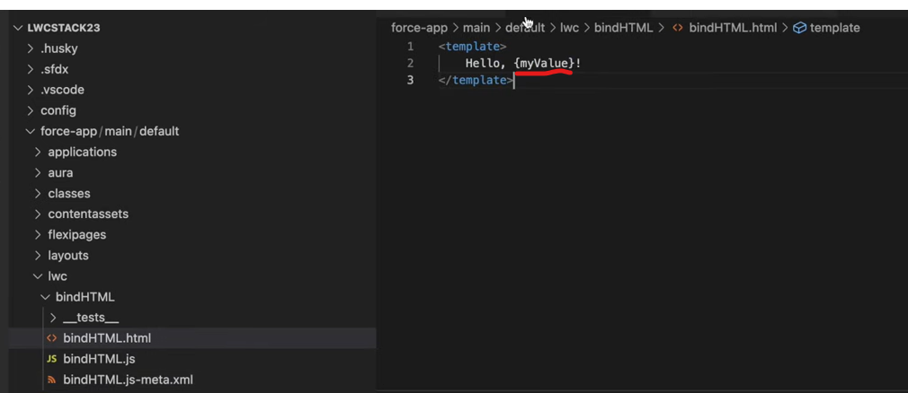
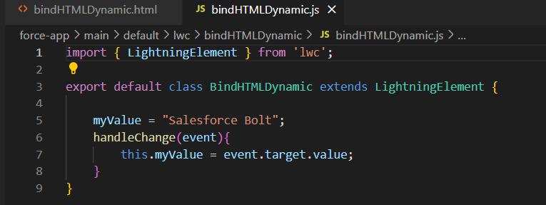
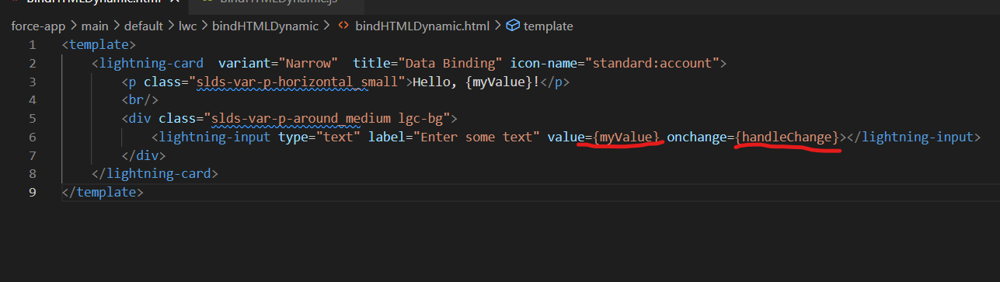
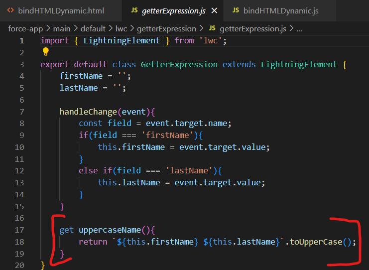
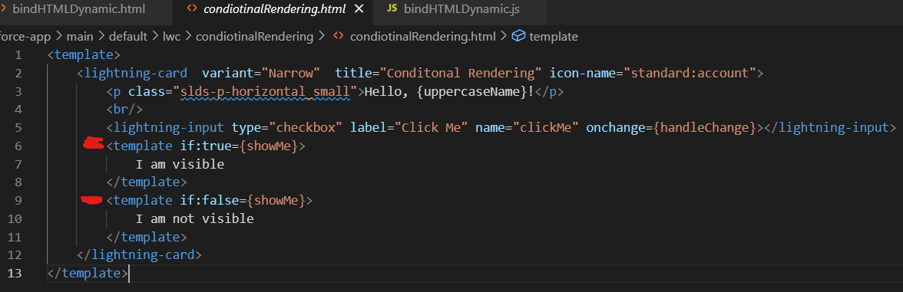
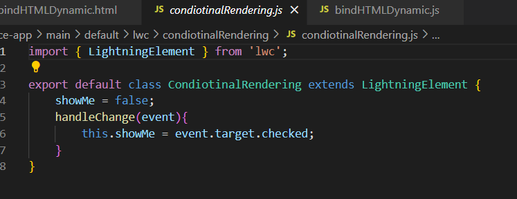

# Data Binding and Rendering

**Data Binding & Rendering in LWC**

1. Use JS variables in HTML file:

1. Use JS variables dynamically:

1. Using getter expressions:

**Conditonal** **Rendering****:**

Using `<template if:true={showMe}> </template>`

