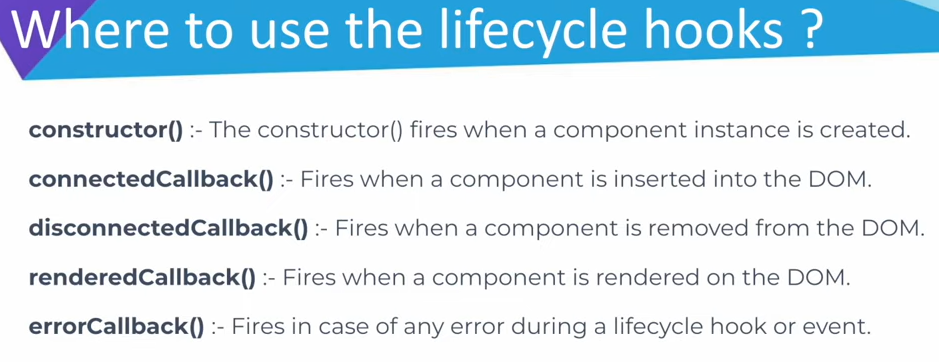
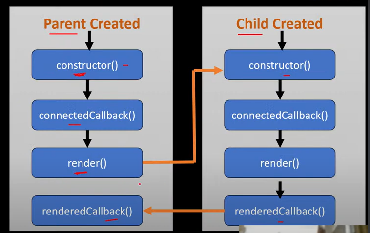
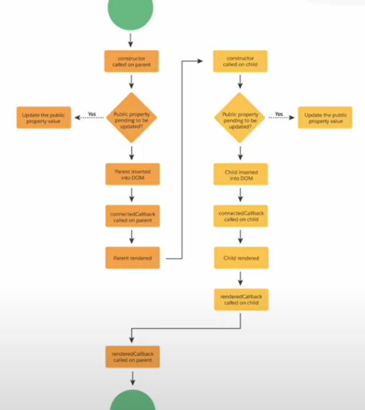
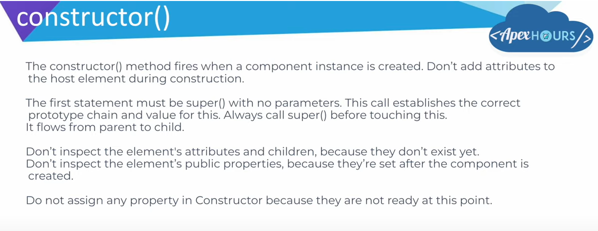
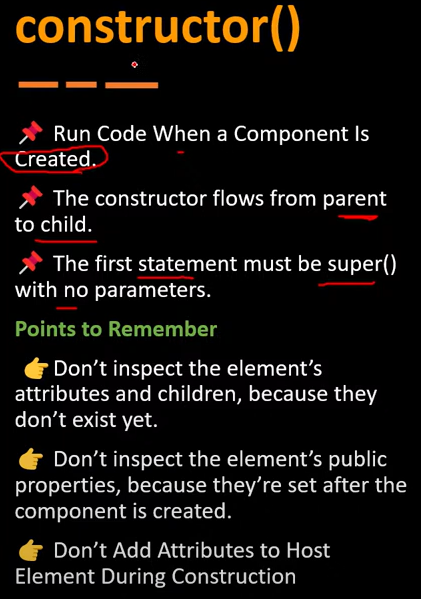
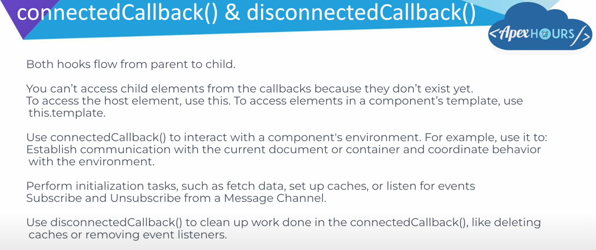
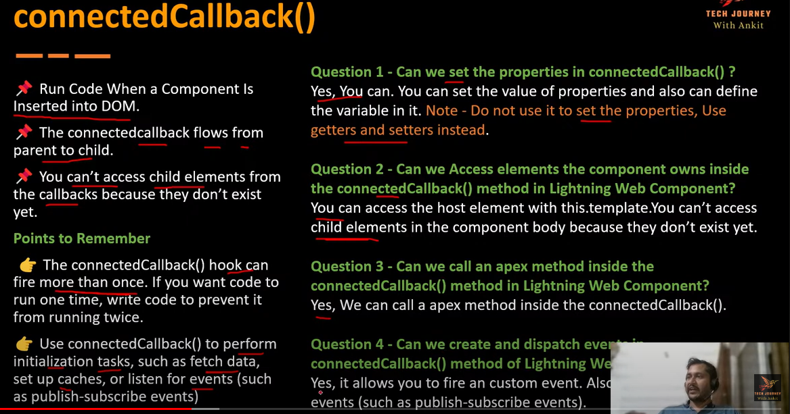
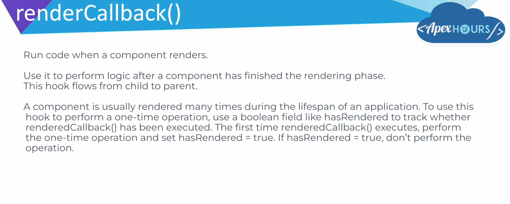
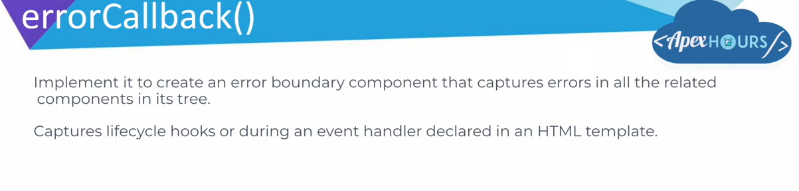

# Lifecycle Hooks:

A lifecycle hook **is a callback method triggered at a specific phase** of a component instance’s lifecycle

# Lifecycle Flow:

use it to:

- Establish communication with the current document or container and coordinate behavior with the environment.
- Perform initialization tasks, such as fetch data, set up caches, or listen for events
- [Subscribe and Unsubscribe from a Message Channel](https://developer.salesforce.com/docs/platform/lwc/guide/use-message-channel-subscribe.html).
- Navigate to different page types, like records and list views using [the lightning/navigation module](https://developer.salesforce.com/docs/platform/lwc/guide/use-navigate-basic.html).
- Work with [third-party web components](https://developer.salesforce.com/docs/platform/lwc/guide/create-use-custom-elements.html).
- The connectedCallback() hook can fire more than one time. For example, if you remove an element and then insert it into another position, such as when you reorder a list, the hook fires several times. If you want code to run one time, write code to prevent it from running twice.

The renderedCallback() perform logic after a component has finished the rendering phase.

This [hook flows](https://developer.salesforce.com/docs/platform/lwc/guide/create-lifecycle-hooks.html) from child to parent.

It’s best to [add event listeners declaratively in an HTML template](https://developer.salesforce.com/docs/platform/lwc/guide/events-handling.html). However, if you do need to add an event listener to a template element programmatically, do it in renderedCallback(). You don’t need to remove the listener. If a listener is added to the same element repeatedly, the browser ignores the duplicates.

Updating the state of your component in renderedCallback() can cause an infinite loop.

Implement it to create an error boundary component that captures errors in all the descendent components in its tree.

It captures errors that occur in the descendant's lifecycle hooks or during an event handler declared in an HTML template.

catches errors that occurs in the descendant components but not itself.
