# Communication between components:

## Parent to Child:

Using @api decorator. 
To expose a public property or a public method, decorate it with @api.

[https://www.youtube.com/watch?v=WbDoaZ1gi3E&ab_channel=SalesforceDevelopers](https://www.youtube.com/watch?v=WbDoaZ1gi3E&ab_channel=SalesforceDevelopers)
[https://www.youtube.com/watch?v=F7J5yn3MIXw&ab_channel=SalesforceDevelopers](https://www.youtube.com/watch?v=F7J5yn3MIXw&ab_channel=SalesforceDevelopers)

**Example** for exposing public property using @api decorator: A value for percentage will be entered on parent, which will be passed to the child component and the child component will change the styling of a bar based on that percentage value.

Child HTML:

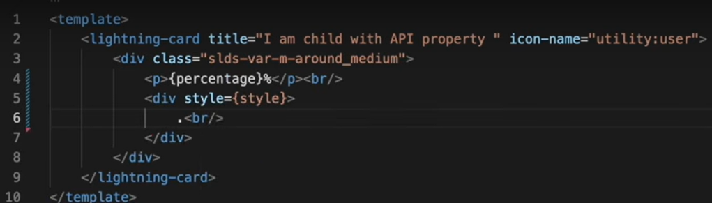

Child JS:

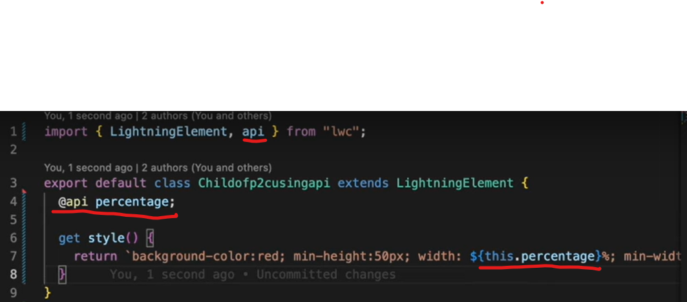

Parent HTML:

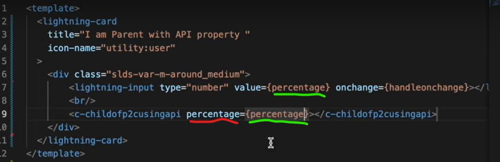

Parent JS:

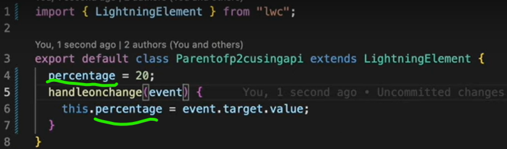

**Example** for exposing public method using @api decorator: Update a timestamp shown on child component by clicking a button on parent.

Child HTML: Not running function from child.

Child JS:

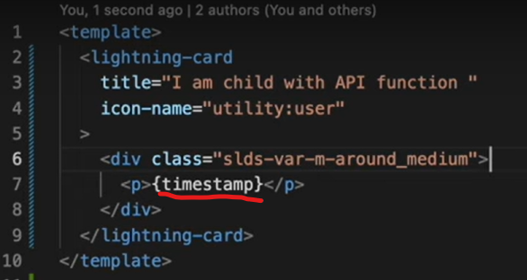

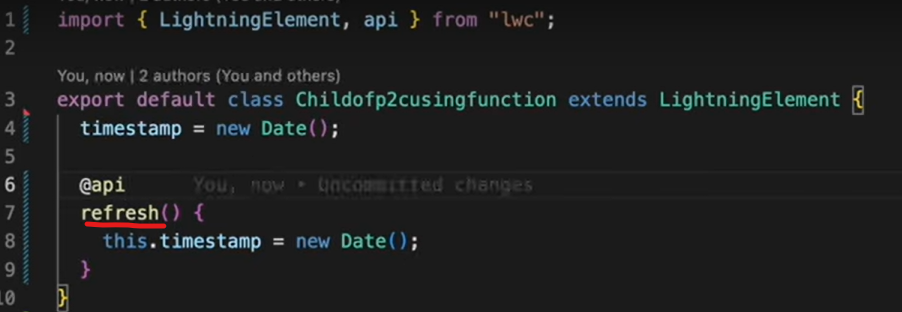

Parent HTML: Not passing any values to child.

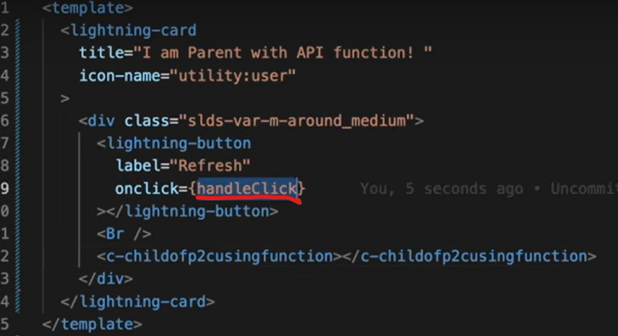

Parent JS: Calling child’s public method(refresh) from parent’s method(handleClick).

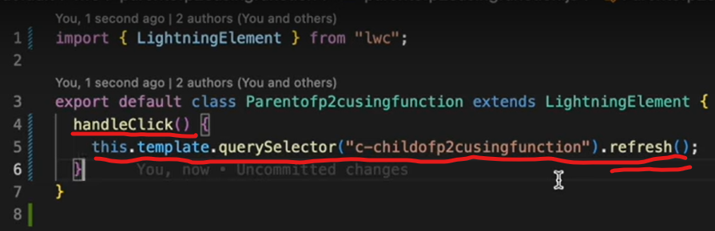

## Child to Parent:

This is achieved by using customEvent(). A custom event can be created on child and can be listned on the parent.

**Example** for bubbling a custom event from child to parent:

Child HTML: On a button click on child a custom event fire.

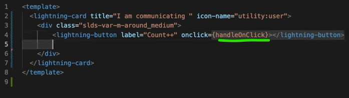

Child JS:

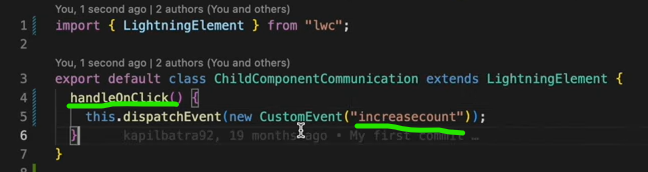

Parent HTML: Parent is listening to the (increasecount) custom event.

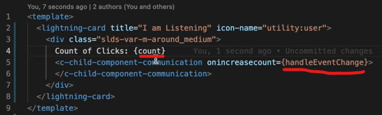

Parent JS: when onincreasecount runs parent listens and runs a handleEventChange function.

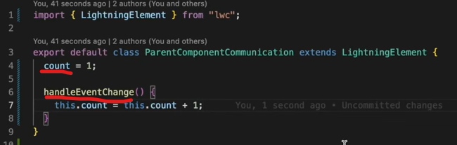

**Example** for passing data from child to parent in a custom event: On button click on child a custom event fires which sends a limit value of the click counter and a message which will be shown when the limit reaches.

Child HTML:

Child JS:

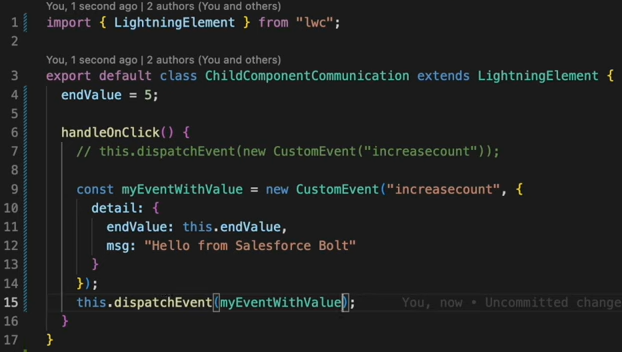

Parent HTML: 

Parent JS:

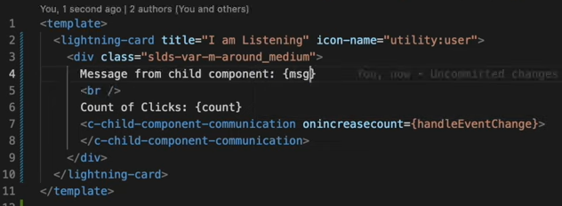

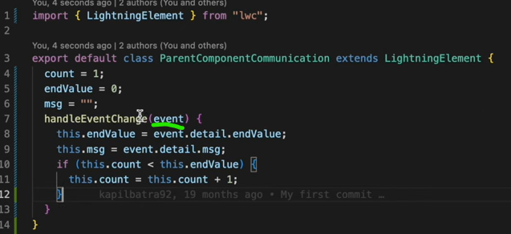

# Communicate with Events

Lightning web components dispatch standard DOM events.

Components can also create and dispatch custom events. Use events to communicate up the component containment hierarchy.

[https://dom.spec.whatwg.org/#events](https://dom.spec.whatwg.org/#events)

[https://developer.salesforce.com/blogs/2021/08/how-events-bubble-in-lightning-web-components](https://developer.salesforce.com/blogs/2021/08/how-events-bubble-in-lightning-web-components)

## Events

To create events in a Lightning Web Component, use the CustomEvent interface, which inherits from Event. In Lightning Web Components, CustomEvent provides a more consistent experience across browsers, including Internet Explorer.

When you create an event, define event bubbling behavior using two properties: bubbles and composed.

**B****ubbles****:** A Boolean value indicating whether the event bubbles up through the DOM or not. Defaults to false.

**C****omposed****:** A Boolean value indicating whether the event can pass through the shadow boundary. Defaults to false.

- **event.target** — A reference to the element that dispatched the event. As it bubbles up the tree, the value of target changes to represent an element in the same scope as the listening element. This event retargeting preserves component encapsulation. We’ll see how this works later on.
- **event.currentTarget** — A reference to the element that the event handler is attached to.
- **event.composedPath****()** — Interface that returns the event’s path, which is an array of the objects on which listeners will be invoked, depending on the configuration used.d.
