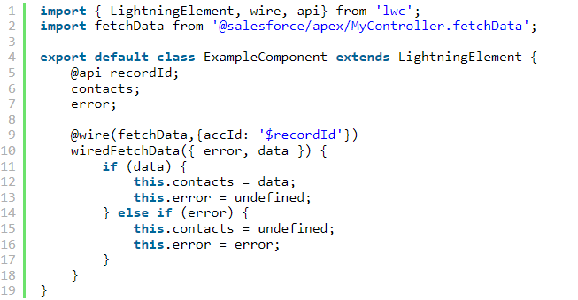
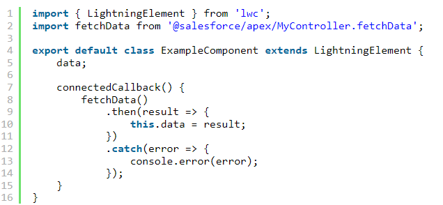

[https://thesalesforcedev.in/2023/04/23/understand-wire-vs-imperative-calls-in-lwc/](https://thesalesforcedev.in/2023/04/23/understand-wire-vs-imperative-calls-in-lwc/)

# Wire vs Imperative Apex Method Calls in Salesforce Lightning Web Components (LWC)

(LWC) provides two ways to call Apex methods – wire and imperative. 
Both are used to retrieve and manipulate data from the server side.

## Wire:

- Wire calls enable the real-time retrieval of data from the server side. Whenever the data changes on the input, the wire call automatically updates the data in the LWC.
- Wire calls work by connecting the LWC with the server-side data source using an adapter. The adapter specifies which Apex method to call and which data to retrieve.
- Whenever the data changes on the server side, the adapter automatically updates the data in the LWC.
- Whenever the LWC loads or updates, it automatically executes the wire call and retrieves the data in real time.

**Example:** This LWC retrieves contact data related to an account using the “fetchData” Apex method. The @wire decorator creates a wire adapter to automatically update the component’s properties with the retrieved data or error.

***Pros of using wired apex method call:***

- Automatic data refreshing: Wired apex method calls provide automatic data refreshing, meaning that any changes made to the data are automatically reflected in the UI without requiring any additional code.
- No need for error handling: Since the wired apex method calls handle errors automatically, you don’t need to write any additional code for error handling.
- Better performance: Wired apex method calls use a reactive programming model and optimize the data transfer between the server and client, resulting in better performance.

***Cons of using wired apex method call****:*

- Limited data manipulation: Wired apex method calls are read-only and do not allow for any data manipulation or updates.
- Limited control over the data: Wired apex method calls automatically fetch and cache data, which can result in less control over the data and its behavior.
- Limited support for complex queries: Wired apex method calls only support simple queries and may not be suitable for more complex queries that require additional logic.

## Imperative:

- Explicitly calls an Apex method using JavaScript.
- Retrieve data from the server side only when needed, such as on page load, button click, or when called from another method.

Example: This LWC retrieves data from an Apex method named “fetchData” imperatively. Here, connectedCallback lifecycle hook is used to call the Apex method imperatively when the component is connected to the DOM.

***Pros of using imperative apex method call:***

- Full control over data: Imperative apex method calls allow full control over data and its behaviour, **allowing for DML operation**s such as updates, inserts, and deletes as needed.
- Support for complex queries: Imperative apex method calls allow for complex queries and additional logic, making them suitable for more complex use cases.
- Better debugging: Since the imperative apex method calls to provide more control over the data, they also allow for easier debugging of issues.

***Cons of using imperative apex method call:***

- More error-prone: Imperative apex method calls require more error handling code since they do not handle errors automatically as wired apex method calls.
- Manual data refreshing: Since imperative apex method calls do not provide automatic data refreshing, you need to write additional code to manually refresh the data.
- Lower performance: Imperative apex method calls require more code and data transfer between the server and client, resulting in potentially lower performance compared to wired apex method calls.
