# Work with Salesforce Data

1. The easiest way to work with Salesforce data is to use base Lightning components built on Lightning Data Service (LDS).
1. If you need more flexibility, use a Lightning Data Service wire adapter directly.
1. Finally, if GraphQL and LDS wire adapters aren’t flexible enough, use Apex.

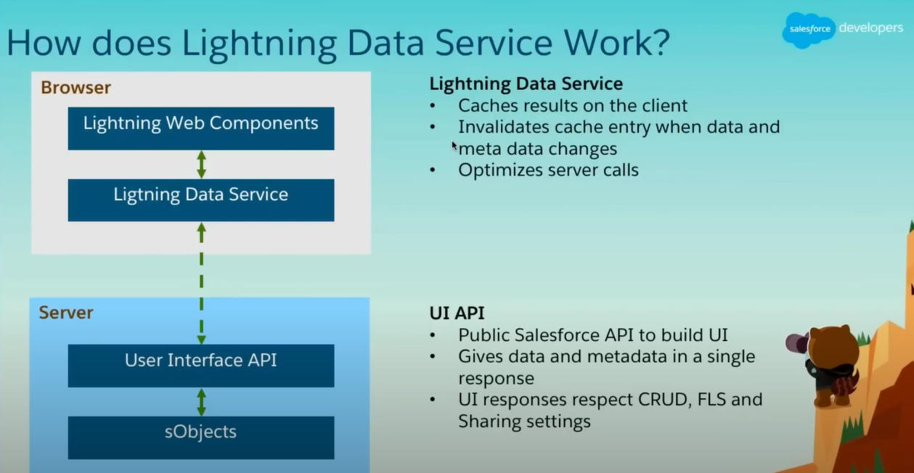

## 1.Use Base Lightning Components Built on Lightning Data Service

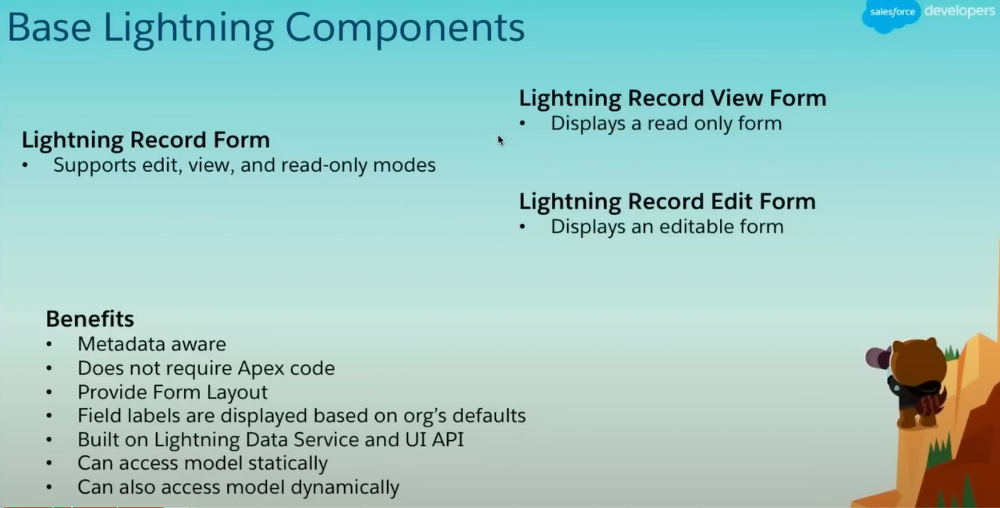

**lightning-record-form,**

- Switches between view and edit modes automatically when the user begins editing a field in a view form
- Provides Cancel and Save buttons automatically in edit forms
- Uses the object’s default record layout with support for multiple columns
- Loads all fields in the object’s compact or full layout, or only the fields you specify
- is less customizable. To customize the form layout or provide custom rendering of record data, use lightning-record-edit-form (add or update a record) and lightning-record-view-form (view a record).
- It takes care of field-level security and sharing for you, so users see only the data that they have access to.
- The component accepts a mode value that determines the user interaction allowed for the form. The value for mode can be one of the following:
- **edit** – Creates an editable form to add a record or update an existing one. When updating an existing record, specify the record-id. Edit mode is the default when record-id is not provided, and displays a form to create new records.
- **view** – Creates a form to display a record that the user can also edit. The record fields each have an edit button. View mode is the default when record-id is provided.
- **readonly** – Creates a form to display a record without enabling edits. The form doesn’t display any buttons.
- object-api-name
- fields
- record-id
- mode

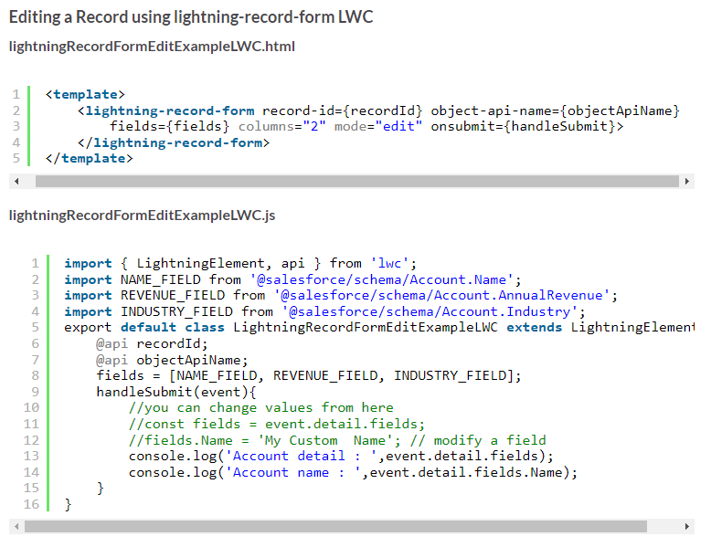

lightning-record-edit-form,

lightning-record-view-form.

provide a UI to view, create, and edit a record—similar to the record detail page in Salesforce.

lightning-record*form

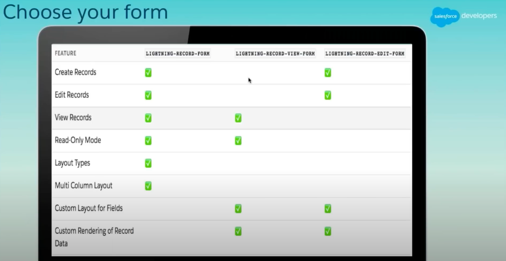

## 2.Use Lightning Data Service Wire Adapters and Functions

The **lightning/****uiGraphQLApi** and **lightning/****ui*****Api** modules provide the Lightning Data Service (LDS) wire adapters and functions.

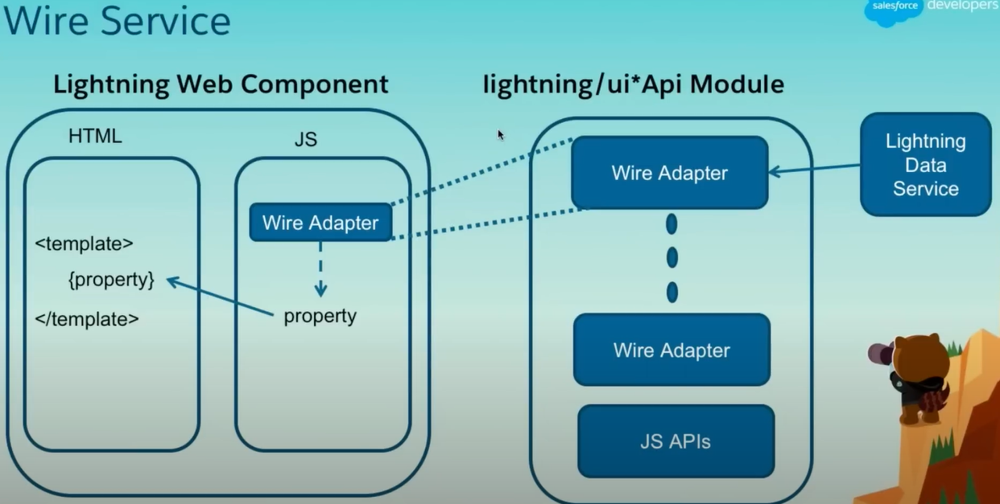

## Graphql

The **lightning/****uiGraphQLApi**  wire adapter manages your data using Lightning Data Service (LDS). You don’t need different wire adapters for each query defined in the GraphQL schema, unlike the other wire adapters. Instead, LDS provides a single wire adapter that accepts a GraphQL query document and a variables map.

## lightning/ui*Api Wire Adapters and Functions

eg,
lightning/uiRecordApi

- import { getRecord } from "lightning/uiRecordApi";

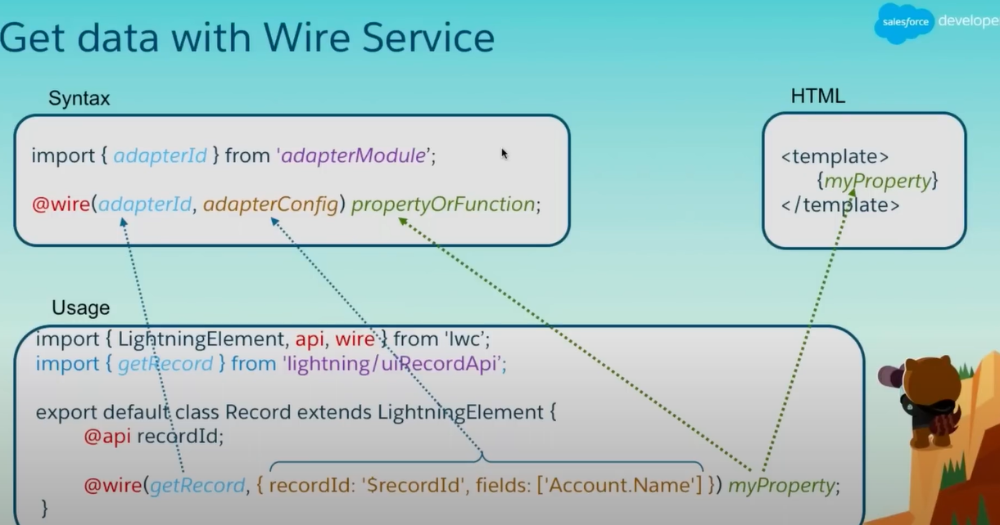

Getrecord wire adapter returning data to a property

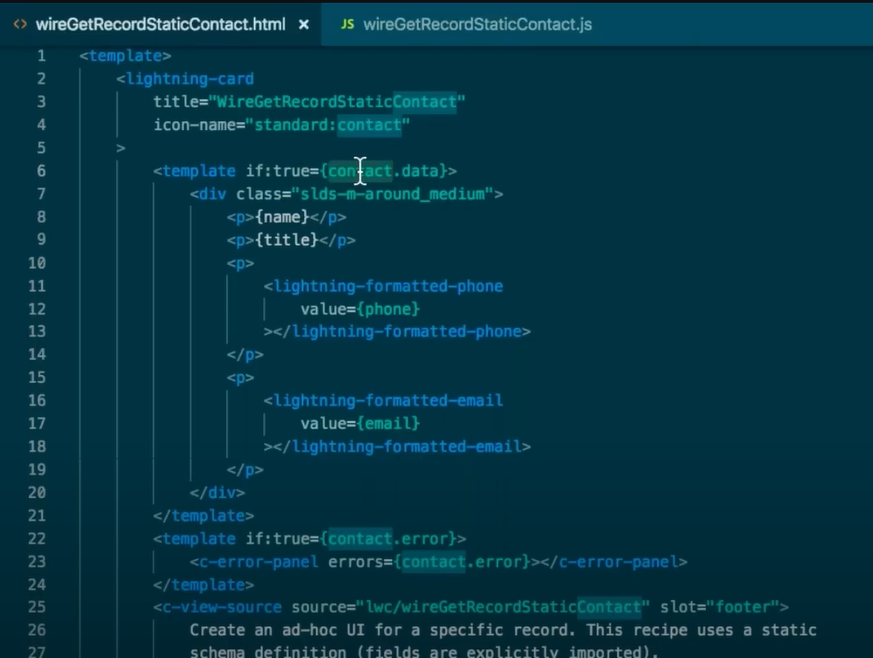

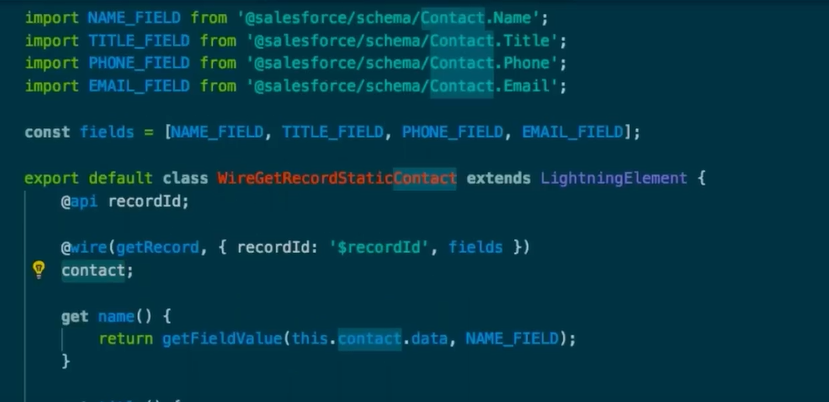

Getrecord wire adapter returning data to a function:

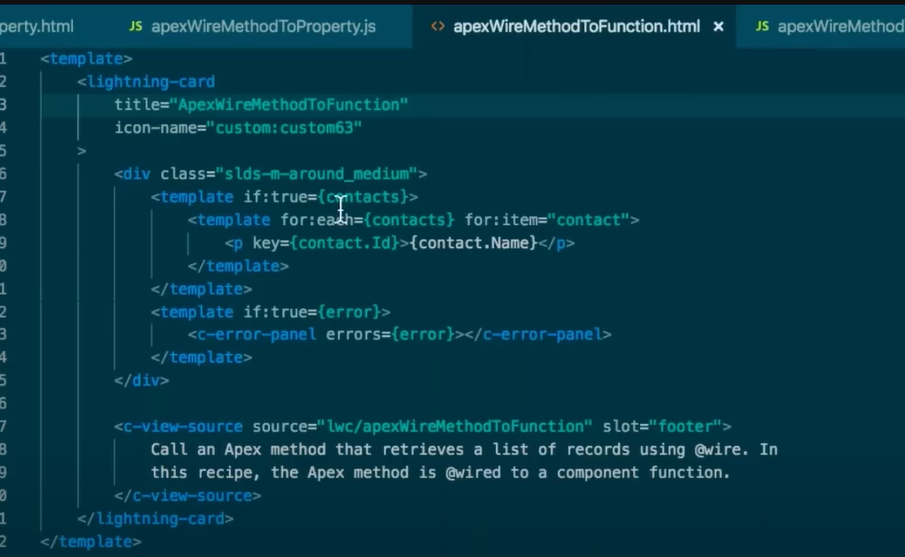

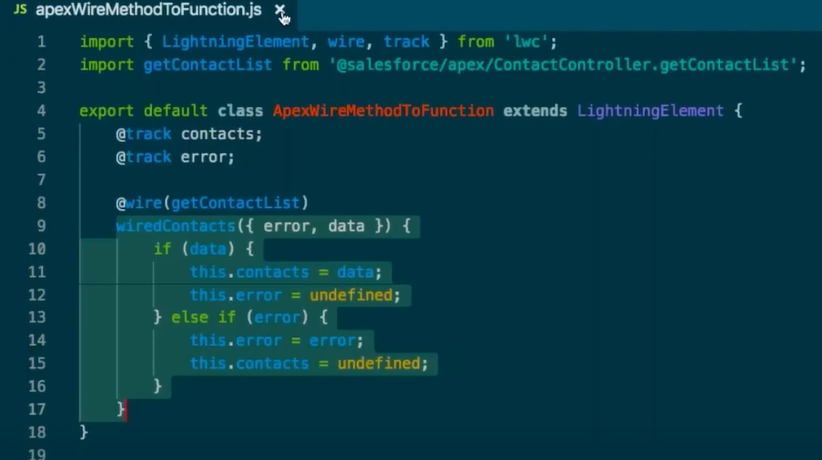

- import { createRecord } from 'lightning/uiRecordApi';
- import { deleteRecord } from 'lightning/uiRecordApi';

## 3. Call Apex Methods

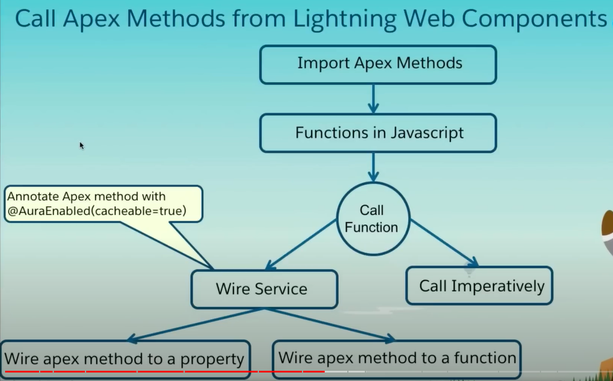

a. Can be wired

**@AuraEnabled(cacheable=true)** has to used to wire apex methods

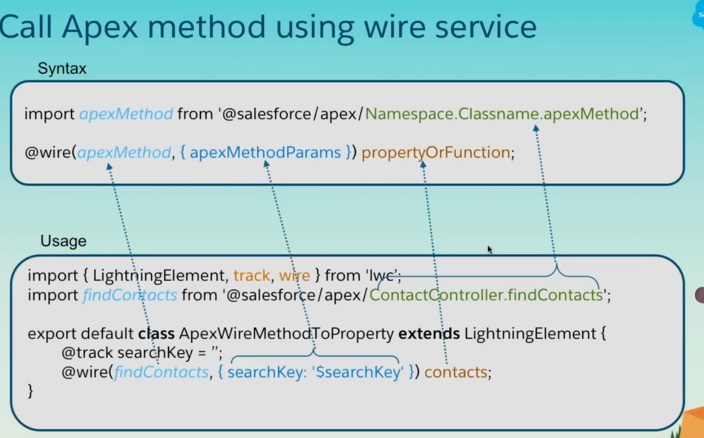

b. Can be called imperatively

**@AuraEnabled(cacheable=true****)** , cacheable is not mandatory. Only @**auraEnabled** works for imperative methods. If we are performing any DML and we are annotating our method with (cacheable=true) it will give you a DMLLimit Exception.

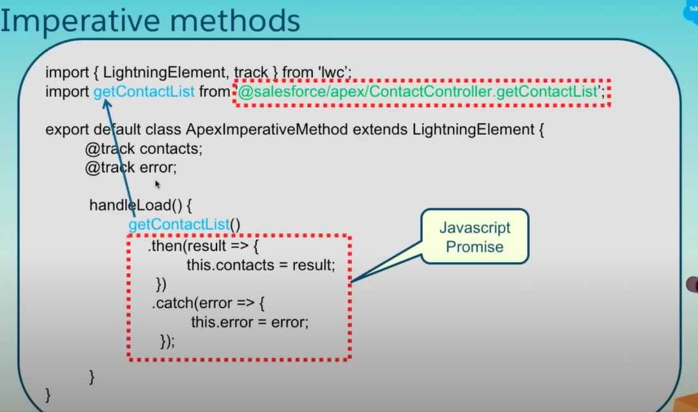

Example: on LOAD CONTACTS button click

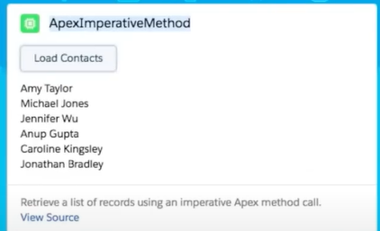

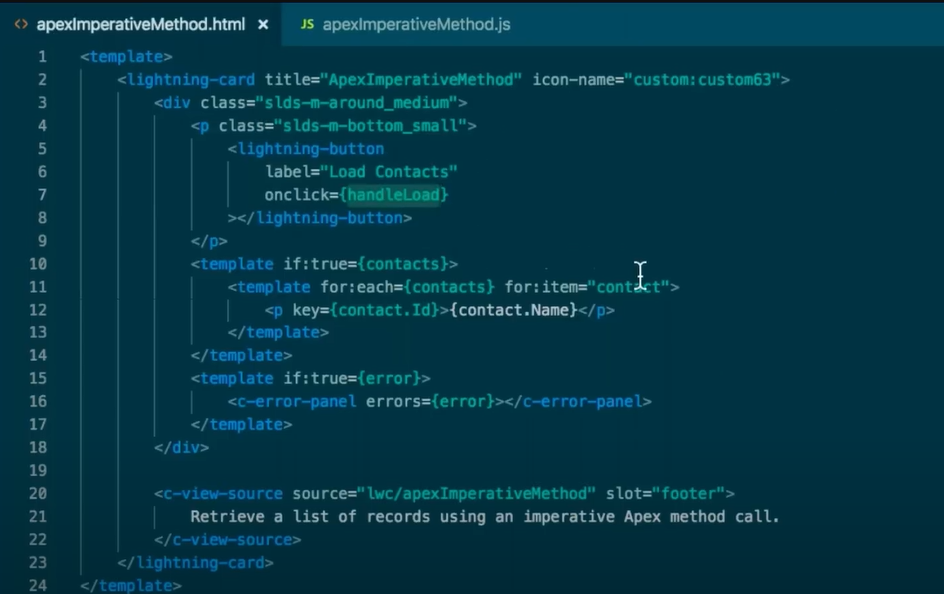

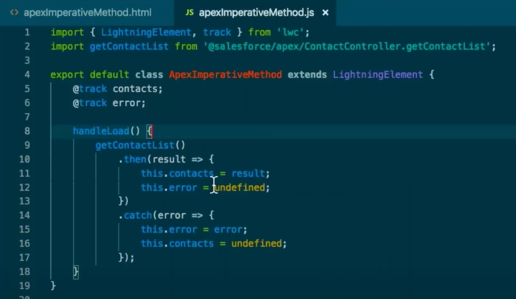
